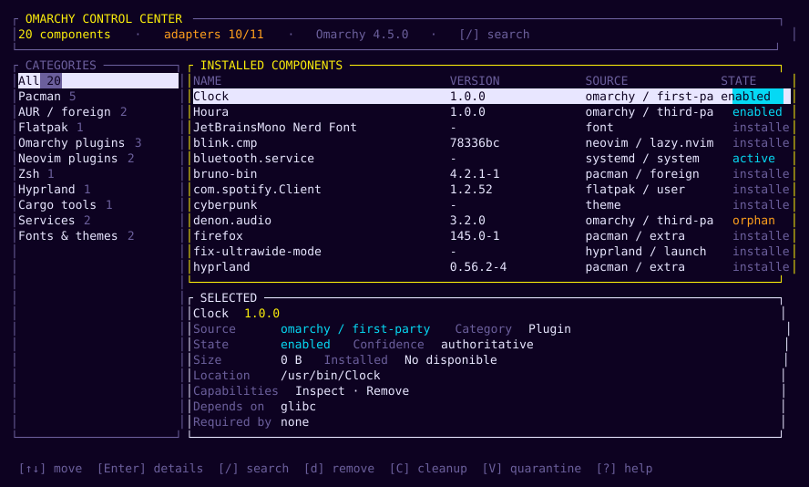
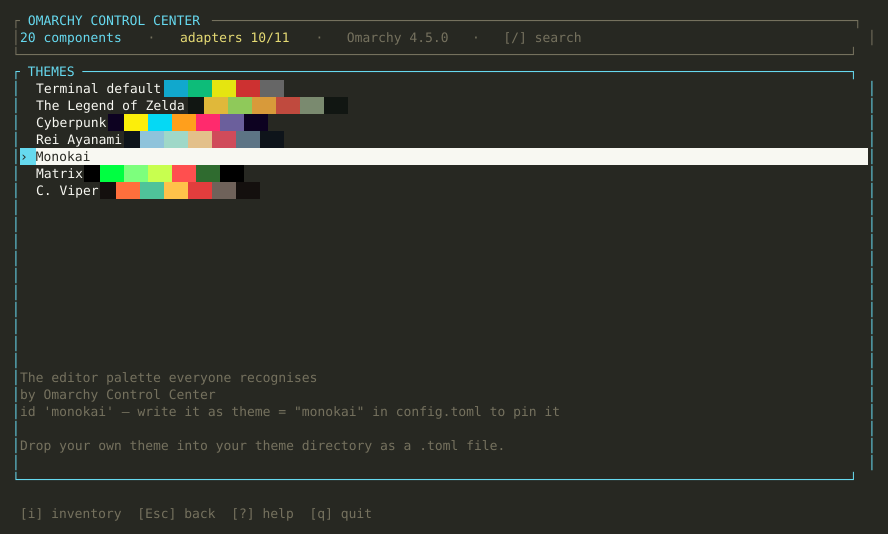
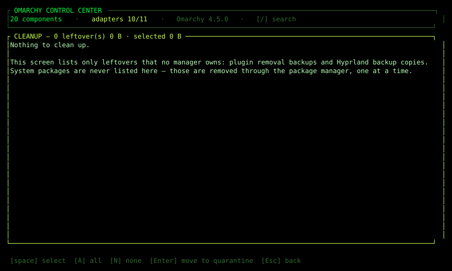

# Omarchy Control Center

A terminal inventory of everything installed on an Omarchy / Arch Linux system —
packages, AUR packages, Omarchy shell plugins, flatpak applications, Neovim plugins,
Zsh plugins, Hyprland configuration, Cargo and Python tools, systemd services, fonts,
themes and icon themes — with lifecycle operations that are safe by construction: every destructive action
shows exactly what will run, what else could be affected, what could not be
determined, and refuses to proceed without the exact name typed back.

The interface never runs as root and never reads a password. It is also not a skin
over `pacman`: adapters own their ecosystem, an unavailable tool is reported as an
unavailable integration instead of an error, and no value is ever invented.



<p align="center">
  
  
</p>

Those images are not screenshots pasted from a terminal: they are produced by the real
renderer. A fixture inventory is drawn into a `ratatui` test buffer and written as SVG, so
they cannot drift from the code. Regenerate with
`cargo test --bin omarchy-control-center -- --ignored`.

## Requirements

| Tool | Needed for | Notes |
| --- | --- | --- |
| Rust 1.88+ (edition 2024) | building | developed against `rustc 1.99.1` |
| `pacman` | the pacman adapter | read-only queries need no privileges |
| `yay` or `paru` | the AUR adapter | optional; without one, AUR is reported unavailable |
| `omarchy` | the plugin adapter | lists, inspects and removes shell plugins |
| `flatpak` | the flatpak adapter | **optional by design**; the program is fully usable without it |
| `nvim` + `lazy-lock.json` | the Neovim adapter | reads files only; no command is run |
| `zsh` + oh-my-zsh | the Zsh adapter | reads `.zshrc` only; it is never modified |
| `systemctl` | the services adapter | inspection only |
| `cargo` | the Cargo tools adapter | removal goes through `cargo uninstall` |
| `uv` or `pipx` | the Python tools adapter | a lazy-install shim is refused, never executed |
| `fc-list` | the resources adapter | fonts; themes and icons are read from their roots |
| `curl` + `sha256sum` | updating the program itself | only for `--check-update` and `--update`; a missing one is reported, never worked around |

Not implemented, and reported as such rather than simulated: AppImage candidates,
inventory comparison between runs, and mutation of anything under `~/.config`
(Hyprland and Zsh are inspected, never edited).

## What it inventories

| Ecosystem | Source of truth | Can remove? |
| --- | --- | --- |
| pacman packages | `pacman -Q` / `-Qi` / `-Qm` / `-Qdtq` | yes, official packages only |
| AUR packages | the pacman foreign set, enriched by `yay -Si` | yes, through the helper |
| Omarchy shell plugins | `omarchy plugin list --json` | yes, third-party only |
| flatpak apps and runtimes | `flatpak list` | yes, when flatpak is installed |
| Neovim plugins | `lazy-lock.json` + `~/.local/share/nvim/lazy` | no — the config still references them |
| Zsh plugins | `plugins=(...)` in `.zshrc` + oh-my-zsh | no — `.zshrc` is never written |
| Hyprland configuration | `~/.config/hypr/*.lua` and `*.conf` | no — a reference is not ownership |
| Cargo tools | `cargo install --list` | yes, through `cargo uninstall` |
| Python tools | `uv tool list` / `pipx list --json` | no — ownership cannot be proven yet |
| systemd services | `systemctl list-units` + `list-unit-files` | no — stop, disable and remove are different actions |
| Fonts, themes, icons | `fc-list` + the theme and icon roots | no — shared resources |

On the machine this was developed on that is 2666 components, 0 failures and 0 duplicate
identities, including 3 Neovim plugins reported as `missing` because the lock file lists
them and no directory exists.

## Install

One command, no root, nothing outside your home:

```sh
git clone https://github.com/TzzJokerzzT/omarchy-control-center.git
cd omarchy-control-center
./install.sh
```

It builds the release binary, installs it into `$XDG_BIN_HOME` (or `~/.local/bin`),
verifies the installed binary runs, installs the short name **`control-center`**, makes
sure that directory is on your `PATH`, and offers to add the Omarchy bar widget. Every
step is printed before it happens; `--dry-run` prints the whole plan and changes nothing.

After that, from any directory and in any terminal:

```sh
control-center                 # the inventory
control-center --read-only     # explore without any destructive action
```

`control-center` is a **link** to the same binary, not a shell alias. An alias would only
exist in an interactive shell that sourced your rc file; a link works from scripts, from
the bar widget, and from `omarchy-launch-tui control-center` too.

```sh
./install.sh --dry-run        # show every step, touch nothing
./install.sh --no-plugin      # binary only
./install.sh --plugin         # binary plus the Omarchy bar widget, no question asked
./install.sh --prefix DIR     # install somewhere else
./install.sh --path           # add the prefix to PATH without asking
./install.sh --no-path        # never touch the shell configuration
./install.sh --help           # all options
```

Requirements: `cargo` and `rustc` (Rust 1.88+; on Arch: `sudo pacman -S --needed rust`).
An Arch-based system is not required, but the pacman, AUR and Omarchy adapters report
themselves unavailable elsewhere.

| What the installer writes | Where |
| --- | --- |
| the program | `<prefix>/omarchy-control-center` |
| the short name | `<prefix>/control-center` (a link to the program) |
| one marked block, only when the prefix is not already on `PATH` | your shell rc file, chosen from `$SHELL` |
| the bar widget (optional) | `~/.config/omarchy/plugins/tzzjokerzzt.omarchy-control-center/` |

The PATH block is written between `# >>> omarchy-control-center >>>` and
`# <<< omarchy-control-center <<<`, so it is added once no matter how often you install,
and removed exactly — the rest of the file is left byte-for-byte as it was. It also
avoids adding a duplicate entry when the file is sourced twice. If you prefer to manage
`PATH` yourself, `--no-path` keeps the installer out of your shell configuration.

The widget is copied only after Omarchy's own validator accepts it, and it is enabled
with `omarchy plugin enable` so the shell state stays consistent.

### Manual install

If you would rather not run a script:

```sh
cargo build --release --locked
install -Dm755 target/release/omarchy-control-center ~/.local/bin/omarchy-control-center
ln -sfn omarchy-control-center ~/.local/bin/control-center    # the short name

# optional bar widget
omarchy plugin validate omarchy-plugin
cp -r omarchy-plugin ~/.config/omarchy/plugins/tzzjokerzzt.omarchy-control-center
omarchy plugin enable tzzjokerzzt.omarchy-control-center
```

## Uninstall

```sh
./install.sh --uninstall                # the program, the short name, the PATH block, the widget
./install.sh --uninstall --purge-state  # …and your configuration, history and quarantine
```

The uninstall removes the `control-center` link and the PATH block it added, restoring
your shell rc file to exactly what it was before the install.

By default an uninstall **keeps your data**, and says where it is:

| Path | Contents |
| --- | --- |
| `~/.config/omarchy-control-center/config.toml` | your configuration |
| `~/.local/state/omarchy-control-center/occ.log` | diagnostic log |
| `~/.local/state/omarchy-control-center/history.jsonl` | every operation you ran |
| `~/.local/state/omarchy-control-center/quarantine/` | files moved out of the way by a cleanup |

`--purge-state` deletes those too, after warning that quarantined files are the only
copy left: the cleanup screen moves things there instead of deleting them, so removing
that directory is the step that makes them unrecoverable. It asks before doing it;
`--yes` skips the question for scripted use.

The widget is removed through `omarchy plugin remove`, so the shell's own bookkeeping is
updated instead of a directory being deleted behind its back.

## Build and run

Building from source without installing anything:

```sh
cargo build --release
./target/release/omarchy-control-center
```

Read-only session — explores everything, offers no destructive action at all:

```sh
./target/release/omarchy-control-center --read-only
```

Headless, no terminal needed (useful over ssh and for scripted inspection):

```sh
# the whole inventory as JSON
omarchy-control-center --print-inventory

# what a removal would run, exactly, without running it
omarchy-control-center --print-plan btop
omarchy-control-center --print-plan some-aur-package
```

## Command line

Everything the interface can show has a headless equivalent, and none of these flags needs a
terminal.

| Flag | What it does |
| --- | --- |
| `--read-only` | explore, with no destructive action exposed at all |
| `--print-inventory` | the whole inventory as JSON, then exit |
| `--print-inventory --adapter ID` | restrict that export to one adapter (see [`docs/adapters.md`](docs/adapters.md) for the ids) |
| `--print-plan ID` | the plan a removal would run — exact argv, affected, blocking, unknown — and exit. Never runs it |
| `--print-plan ID --kind KIND` | plan an `update` or a `reclaim` (quarantine) instead of a `remove` |
| `--check-update` | is there a newer release? One line; reads the network only |
| `--update --yes` | download, verify and install the newest release (see [Updates](#updates)) |
| `--config FILE` | use this configuration instead of the XDG location |
| `--log-level LEVEL` | `error`, `warn`, `info`, `debug` or `trace`, for the log file |
| `--extra-search-path DIR` | look for tools in `DIR` first, before the inherited `PATH` |
| `--yes` | answer a confirmation that would otherwise be asked |
| `--version`, `--help` | the version you are running; the full surface |

## Keyboard

| Key | Action |
| --- | --- |
| `↑` `↓`, `k` `j` | move inside the focused pane |
| `Tab`, `←` `→` | switch between the category sidebar and the list |
| `Enter` | details of the selected component; from details, go back |
| `/` | search by name, identifier, description or source (`Enter` keeps, `Esc` clears) |
| `d` | preview a removal (only when the adapter supports it) |
| `u` | preview an update (flatpak only — see limitations) |
| `H` | operation history |
| `C` | cleanup: leftovers that can be moved into quarantine |
| `V` | quarantine: restore what was moved, or purge it for good |
| `t` | themes: preview a palette and apply it |
| `a` | adapter status and per-adapter issues |
| `?` | help, including what every state means |
| `q`, `Q`, `Esc` | quit; never interrupted while a command is running |

`Enter` on a row only opens details. It never removes anything.

## What the interface guarantees

* **Nothing destructive on navigation.** Opening, searching and browsing never runs a
  mutating command. The only mutating commands are the ones in a confirmed plan.
* **Every removal is previewed.** Exact argv, whether root is required, whether the
  terminal is handed over, affected dependents, files owned by the package, and an
  explicit "not determined" section.
* **Confirmation is not a `y`.** You type the component's native identifier
  (`btop`). Anything else, including `yes`, does nothing.
* **Stale plans do not execute.** The plan is recomputed right before execution and
  compared by fingerprint; a changed or vanished component cancels the action.
* **A broken adapter is isolated.** Each adapter reports its own availability, and a
  missing tool or a panicking integration never stops the others.
* **No invented facts.** Absent values render as `No disponible`, and every component
  names the exact command that detected it.

## Cleaning up leftovers (`C`)

Orphans are not one thing, and the difference decides what may happen to them.

| Kind | What this program does |
| --- | --- |
| A leftover directory or file nobody owns — a plugin removal backup, a Hyprland `*.bak` copy | **Moved into quarantine.** You get a preview with the exact paths and the total size, then a phrase to type. It can be restored. |
| A package the package manager no longer needs (AUR / pacman orphan) | **Not in the cleanup list.** It appears in the inventory with the `orphan` state and is removed through the manager that owns it, one package at a time. |
| A systemd service | Inspection only. Stopping, disabling and removing are three different actions. |

On the reference machine the cleanup screen finds 62 leftovers (1.4 MiB): 23 plugin
removal backups that `omarchy plugin list` hides and 39 Hyprland backup copies.

Two steps, on purpose:

1. **Quarantine** (`C`, select, `Enter`) moves the item to
   `~/.local/state/omarchy-control-center/quarantine/<stamp>/` and records the original
   path in a ledger. Restore it from `V`. Nothing is deleted, and the space is not free
   yet.
2. **Purge** (`V`, `p`, type the exact phrase) deletes a quarantined entry for good. It
   only accepts what the ledger recorded, so it can never be pointed at an arbitrary
   path.

Why not one "delete all orphans" button: a path is verified before it moves (direct child
of a root the adapter owns, canonicalised, never a symlink, size unchanged since the
preview), and a bulk delete would throw that away for the one case that matters.

## Omarchy bar widget

`omarchy-plugin/` contains a real Omarchy shell plugin: a bar button that opens the
control center, or the installation instructions when the binary is not on `PATH`.

```sh
./install.sh --plugin    # validates, copies and enables the widget
```

Left click opens the inventory in a terminal, right click reuses an open window, and an
uninstalled binary opens the *Build and run* section of this README in the browser.

Note: `omarchy plugin add <git-url>` clones a repository whose **root** is the plugin, so
it cannot install from a subfolder of this project. Copying the folder is the honest
instruction until the widget lives in its own repository — see
[`docs/roadmap.md`](docs/roadmap.md).

## Updates

Releases are published on this project's
[GitHub releases page](https://github.com/TzzJokerzzT/omarchy-control-center/releases), and
nothing is installed that cannot be verified first.

```sh
control-center --version          # what you are running
control-center --check-update     # is there something newer? one line, reads only
control-center --update --yes     # download, verify, swap the binary
```

`--update` **refuses to install without a published checksum**: the release must ship a
`SHA256SUMS` asset, the download is verified against it, and a mismatch stops before a single
byte touches the installed binary. Downloaded content is never executed — the new binary is
written next to the current one and swapped in with an atomic rename, and it takes effect
the next time you start it.

It stops, and says why, when:

| Situation | What you see |
| --- | --- |
| the release publishes no `SHA256SUMS` | that the download cannot be verified |
| the release publishes no binary for your platform | the assets it *did* publish, listed |
| the hash does not match | both hashes — and the installed binary is left byte-for-byte as it was |
| `curl` or `sha256sum` is missing | the missing tool, named; nothing is guessed or worked around |
| you are already on the newest release | `vX.Y.Z is already the newest release; nothing to do` |

Requirements and limits:

* The API is GitHub's, read with `curl` over HTTPS only (`--proto =https`), with a deadline on
  every request.
* Only the published `x86_64-linux` binary is offered. Another architecture gets that refusal,
  not a substitute.
* Release candidates (`v0.4.0-rc1`) are published as prereleases, and the check never offers
  them: it answers with the newest release that is not one.
* `--update` replaces the file it is running from, so the new version is in place after the
  swap; it never re-executes it for you.

### Being told without asking the command line

The interface can show it too, but only if you ask for it:

```toml
# ~/.config/omarchy-control-center/config.toml
check_for_updates = true
```

With that on, the program reads the release API once at startup, in a background thread, and
shows `↑ vX.Y.Z` in the header when a newer version exists. It never installs anything from
there, and a failed check goes to the log instead of your screen. Off by default: a program
that contacts a server should be asked to, not assumed to.

### If a package manager owns the binary

`--update` replaces **the file the program is running from**. If you installed it with
`install.sh` (or by hand into `~/.local/bin`), that file is yours and the swap is clean.

If you ever install it as a distribution package, do not point `--update` at it: you would
overwrite a file the package manager believes it owns, and the next upgrade would collide with
it. Use `--check-update` to learn that a new version exists, and update it the way you installed
it. `control-center --version` plus your package manager's records tell you which case you are in.

Re-running `./install.sh` is always a valid update too: it rebuilds, reinstalls and verifies the
binary, and the `PATH` block is only ever written once.

### Where the download goes

A downloaded binary waits in `~/.local/state/omarchy-control-center/update/` and is removed after
the swap or after a checksum mismatch. An interrupted download can leave a partial file there;
it is never executed, and the next `--update` overwrites it.

## Themes

Six palettes ship with the program, plus a `default` that keeps your terminal's own colours:

| Id | Theme |
| --- | --- |
| `zelda` | The Legend of Zelda — parchment, forest green, Triforce gold |
| `cyberpunk` | Night City signage — hot yellow on deep purple |
| `rei` | Rei Ayanami — Unit-00 pale blue, hospital white, cold red |
| `monokai` | The editor palette everyone recognises |
| `matrix` | Green phosphor on black |
| `cviper` | C. Viper — charcoal suit, white shirt, an orange that hits |

Press `t` to open the selector: `↑`/`↓` previews, `Enter` applies and remembers, `Esc` keeps
the previous one, and **`c` starts your own theme** — it writes a ready-to-edit file seeded
from the highlighted palette into `~/.config/omarchy-control-center/themes/`, and the new
theme appears in the list straight away. The selector also shows the id to write into your
configuration.

**Your own theme** is a small TOML file in
`~/.config/omarchy-control-center/themes/` (press `c` in the selector to get a starter file);
the file name is the id:

```toml
# ~/.config/omarchy-control-center/themes/sunset.toml
name = "Sunset"
description = "Warm, low contrast"

[colors]
background = "#201010"
foreground = "#ffeee0"
selection  = "#3a1f1a"
muted      = "#806058"
accent     = "#ff8a5c"
success    = "#8fd18f"
warning    = "#ffc857"
error      = "#ff5c5c"
```

`muted`, `accent`, `success`, `warning` and `error` are required; the rest are optional and
fall back to your terminal. Unknown keys are rejected rather than ignored, a file that fails
to load is reported in the selector with the exact field, and you cannot shadow a built-in
id. Full rules: [`docs/themes.md`](docs/themes.md).

## Configuration

Optional file at `~/.config/omarchy-control-center/config.toml` (see
`config.example.toml`). An invalid file is reported and the defaults are used, so a
typo never prevents the inventory from opening.

## Files it writes

| Path | Contents | Mode |
| --- | --- | --- |
| `~/.config/omarchy-control-center/config.toml` | your configuration (only if you create it) | — |
| `~/.local/state/omarchy-control-center/occ.log` | diagnostic log: commands, exit codes, errors | `0600` |
| `~/.local/state/omarchy-control-center/history.jsonl` | one line per executed operation | `0600` |
| `~/.local/state/omarchy-control-center/update/` | a downloaded release while `--update` runs | `0755` |

The history stores timestamp, adapter, component, operation, result, exit code,
command and error summary. It never stores passwords, tokens, environment variables
or configuration content.

## Documentation

* [`docs/architecture.md`](docs/architecture.md) — layers, adapter contract, operation lifecycle.
* [`docs/adapters.md`](docs/adapters.md) — every adapter, every command it runs and why.
* [`docs/security.md`](docs/security.md) — threat model, privilege handling, and the automated tests behind each guarantee.
* [`docs/themes.md`](docs/themes.md) — the palette slots, the built-ins, and how to write your own theme.
* [`docs/versioning.md`](docs/versioning.md) — the version scheme and how a release is cut.
* [`CHANGELOG.md`](CHANGELOG.md) — what changed in each version.
* [`docs/roadmap.md`](docs/roadmap.md) — every deferred item, with its blocker.
* [`CONTRIBUTING.md`](CONTRIBUTING.md) — how to report a problem and how a change gets merged.
* [`docs/maintenance.md`](docs/maintenance.md) — what lives where, how the branch rules are
  re-applied (`scripts/protect-main.sh`), and what survives deleting the clone or the
  repository.

## Contributing

`main` is protected: it needs one approval, a CODEOWNERS review and a green `ci` run, and
pull requests can only be opened by collaborators. If you have a fix and you are not one, open
an issue with the patch attached. Issues are open to everyone. See
[`CONTRIBUTING.md`](CONTRIBUTING.md) for the flow and the rules a change must respect.

## Development

```sh
cargo fmt --check
cargo clippy --all-targets -- -D warnings
cargo test          # 287 tests, no system modification, no root
```

Tests use fake executables and canned command output; nothing in the suite installs,
removes or upgrades a package.

## Known limitations

These are real, and the program does not pretend otherwise.

* **Cleanup moves things; it does not delete them.** Freeing the space takes a second,
  explicit purge step, and that is the only step that deletes anything this program did
  not create.
* **Removal is offered for four ecosystems only** — pacman, the AUR helper, Omarchy
  plugins and Cargo — because those have a manager that owns the files. Everything else
  is inspection: deleting a plugin directory or a font because a name matched is exactly
  what this program refuses to do.
* **Component updates are only offered for flatpak.** Arch does not support partial
  upgrades, so a per-package update would be a lie; a whole-system upgrade is a different
  operation with different consent, and is not in this version. The program can update
  **itself** — see [Updates](#updates) — which is a different thing entirely.
* **Removals never cascade.** If anything requires a package, the operation is blocked
  and the dependents are listed. `-Rns`, `-Rdd` and orphan batches are not offered.
* **The interface waits during a privileged command.** A removal hands the terminal to
  `sudo`, then `pacman`; the interface is unavailable until that finishes. This is the
  price of never reading a password ourselves.
* **A command that forks a long-lived grandchild may outlive its deadline.** The child
  is killed and the interface stops waiting at the deadline, but the reader threads are
  detached rather than joined, so the pipe can stay open server-side.
* **flatpak's present path is verified through fixtures only** on the machine this was
  developed on (no flatpak installed there). Its unavailable path is verified live.
* **A lazy-install shim is never executed.** `uv` behind mise would install itself on
  first run, so the Python adapter reports the integration as unavailable with that
  reason instead of triggering an install. On the reference machine that is exactly what
  happens.
* **No visual verification in a headless environment.** The TUI needs a real terminal;
  without a TTY the program exits with a clear message instead of corrupting the shell.
